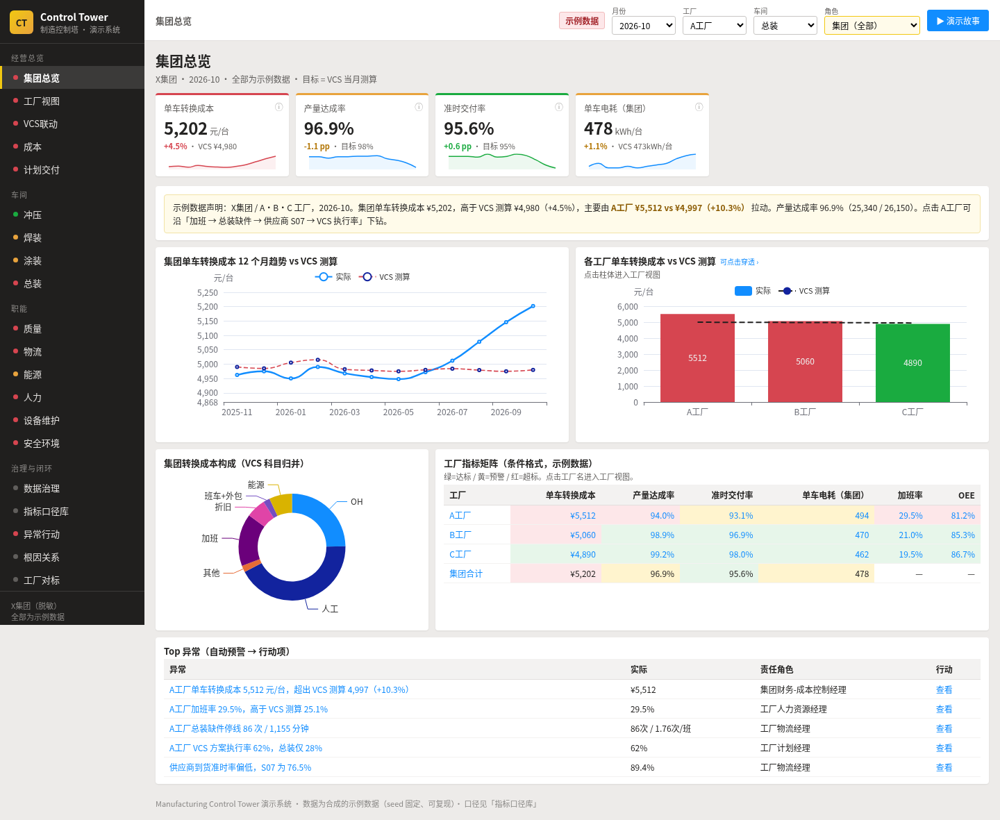
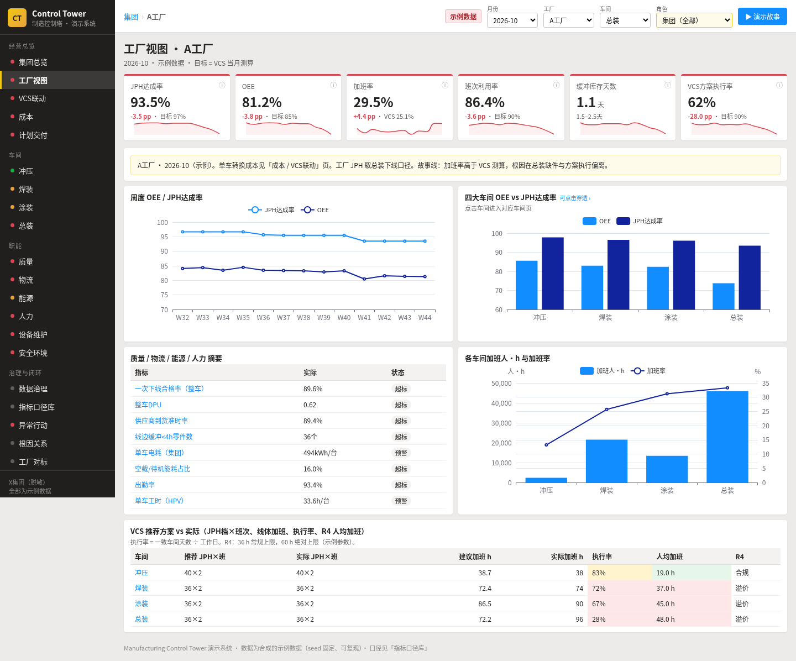
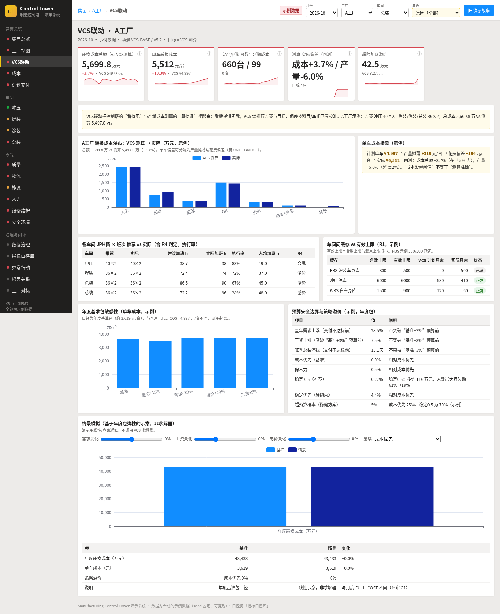

# Manufacturing Control Tower（演示系统）

X集团 / A·B·C 工厂制造控制塔的**可本地运行演示**：分层示例数据仓、58 项看板指标注册表、Power BI 风格 Web 看板（含 **VCS 联动**），以及业务设计与技术文档。

> **全部为示例数据。** 企业、工厂、零件、供应商、设备名称已脱敏。A 工厂 2026-10 的计划/目标值对齐 VCS 手册第 12 节 FULL_COST 综合算例（该算例本身也是设计/示例数据）。已作废的固定目标 ¥4,600、加班 ≤8%、HPU ≤9.0、在册 548 人不再使用；目标一律为「= VCS 当月测算」或文档中的固定阈值。

## 先给业务 / 面试官（3 分钟）

1. 读 **[业务设计一页纸](docs/业务设计一页纸.html)**：为谁、决策链、核心 6 页、12 个 KPI、刻意不做。  
2. 本地启动后点右上角 **「演示故事」**（约 5 分钟）：集团 → A 工厂 → 总装缺件 → 物流 S07 → VCS 联动 → 行动闭环。  
3. 需要战略叙事再看 [亚太数字化战略面试备忘](docs/APAC_数字化战略面试备忘.html)；口径争议看 [VCS_Data_Review.md](VCS_Data_Review.md)；实现细节看技术文档附录。

**页面口径：** 对外讲解用 **核心演示 6 页**；侧栏其余为 **扩展页**（职能 / 治理），证明可扩展，不是当前故事核。全库 58 项指标，讲解只抓一页纸上的核心 12 项。

| 核心 6 页 | 首屏问题 |
| --- | --- |
| 集团总览 | 谁在拉高集团单车转换成本？ |
| 工厂视图 | 钱、加班、方案执行哪里歪了？ |
| 总装 | 停线是否主要因缺件？落到哪一零件？ |
| 物流 | 哪家供应商拖累准时率？ |
| VCS 联动 | 摊薄 vs 花费？方案跑偏在哪？ |
| 异常行动 | 预警是否变成可关闭待办？ |



<p align="center"> </p>

## 快速开始（macOS / Linux）

需要 Python 3.10+。运行时只依赖标准库；构建数据包、测试与文档才需要 `requirements.txt` 中的可选包。

```bash
chmod +x run.sh
./run.sh
# 浏览器打开 http://127.0.0.1:8050
```

若本地还没有 `data/control_tower.db`，脚本会先跑一遍 ETL（约数秒）。端口可用环境变量 `CT_PORT` 修改。可选 `CT_USE_VENV=1 ./run.sh` 自动创建 `.venv` 并安装依赖。

分步命令：

```bash
python3 -m etl.pipeline            # 生成 SQLite 与 config/metrics.yaml
python3 -m etl.export_pack         # 导出 data_pack/（CSV + XLSX）
python3 -m pytest tests/ -q        # ETL / 对账 / API 测试
python3 app.py --port 8050         # 启动 Web
python3 -m etl.local_runner --keep-ods   # 只重算 DWD/ADS
```

口径若需与上游看板示例对齐：把 `../ControlTower/_src/data.py` 与 KPI 清单同步进来：

```bash
python3 tools/sync_story.py
python3 -m etl.pipeline
```

前端 ECharts 已放在 `app/static/vendor/`，无需外网。所有 API 响应带 `X-Data-Label: EXAMPLE-DATA`。请求头 `X-CT-Role`（`group` / `plant_A` / `plant_B` / `ga_A` / `logistics_A`）模拟行级权限。

## 目录

| 路径 | 说明 |
| --- | --- |
| `docs/业务设计一页纸.html` | **业务 / 面试首选**：决策链与核心 KPI |
| `docs/APAC_数字化战略面试备忘.html` | 亚太数字化战略岗口述框架 |
| `etl/` | 源数据生成、分层转换、指标计算、本地 runner、数据包导出 |
| `dags/control_tower_daily.py` | Airflow DAG 示例（不必安装 Airflow） |
| `app/` | Web 服务与看板（核心 6 页 + 扩展页，含 **VCS联动**） |
| `config/` | `story_targets.json`、`kpi_list.json`（58 项）、`metrics.yaml` |
| `data/control_tower.db` | 示例库（**不入库**；首次 `./run.sh` 或 `python3 -m etl.pipeline` 自动生成） |
| `data_pack/` | Power BI 可用的 CSV + `Control_Tower_DataPack.xlsx` |
| `tests/` | 对账与接口测试 |
| `docs/` | 技术文档、看板说明、架构 / ER 图 |
| `screenshots/` | 关键页截图（示例） |

## 故事月锚点（A 工厂 2026-10，示例）

产量 11,000 计划 / 10,340 实际（94.0%）；单车转换成本 5,512 vs 计划 4,997（+10.3%）；总额 5,699.8 万 vs 5,497.0 万；加班率 29.5% vs 计划 25.1%，加班 83,284 人·h；VCS 执行率 83/72/67/28%（均 62%）；单车电耗 494 vs 473 kWh；HPV 33.6；人工 3,241 元/台；在册 1,962；推荐方案 40×2 / 36×2 / 36×2 / 36×2；PBS 500/500；欠产延期 99 万；集团单车成本 5,202 vs 4,980。

**两种缓冲：** 「外购件缓冲天数」= 零部件库存天数；「车间间缓存 / PBS」= 车身台数上限——可同时一紧一满，对象不同。

许可与用途：面试作品集脱敏模板，不用于生产，不含真实企业凭据。
