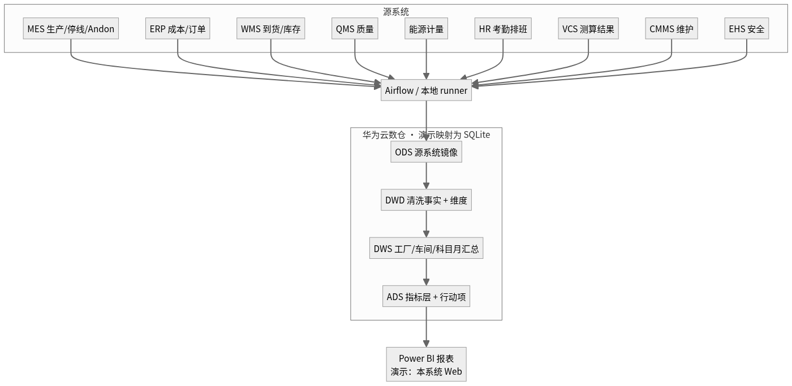
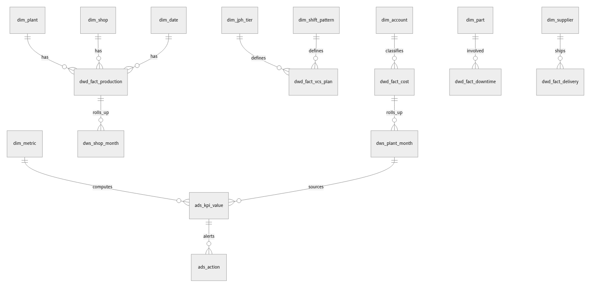

> 本文与合订本 `Control_Tower_技术文档.docx` / `.pdf` 内容一致。架构图与 ER 图见 `diagrams/`。**全部为示例数据。**
# Manufacturing Control Tower
技术文档（演示系统 · 脱敏模板）
X集团 / A·B·C 工厂  ·  全部为示例数据  ·  2026-11-14（Asia/Shanghai）
示例数据声明：本文档及配套系统、数据包、看板中的企业、工厂、零件、供应商、设备名称均已脱敏（X集团、A/B/C 工厂、零件号 P-xxxxx、供应商 S01–S14）。所有数字均为示例数据，不代表任何真实企业经营数据。A 工厂 2026-10 的计划/目标值对齐 VCS 手册 第12节 FULL_COST 综合算例（该算例本身亦为设计/示例数据）。已作废的固定目标 ¥4,600、加班 ≤8%、HPU ≤9.0、在册 548 人不再使用，目标一律为「= VCS 当月测算」或文档中的固定阈值。

## 1. 系统概述与范围
本系统是制造控制塔（Manufacturing Control Tower）的可本地运行演示：用一套分层数仓和统一指标层，把集团—工厂—车间三层运营结果与 VCS 产量成本测算联动起来，支持下钻、对标、异常到行动的闭环，以及面试演示路径。
范围包括：① 合成但口径自洽的 12 个月示例数据（3 工厂 × 四大车间及质量/物流/能源/人力等职能）；② ODS/DWD/DWS/ADS 分层与数据质量规则；③ 58 项看板指标 + 体系建设补充指标的注册表与计算；④ 可离线运行的 Web 看板（含 VCS联动页）；⑤ Airflow DAG 示例与本地 runner；⑥ 本技术文档与 Power BI 数据包。
不在范围：真实源系统接入、华为云生产部署、VCS 求解器本身（演示只消费测算结果并做线性情景示意）、预测/仿真的生产级实现。

## 2. 总体架构
生产目标形态：MES / ERP / WMS / QMS / EMS / HR / VCS / CMMS / EHS → Airflow 调度抽取与校验 → 华为云数仓（ODS 源镜像 / DWD 清洗事实与维度 / DWS 汇总 / ADS 指标与应用）→ Power BI 报表，由联邦治理规定口径、校验与变更。
演示映射：同一套分层与口径在本地 SQLite 中实现；Airflow 由 etl/local_runner.py（或 python3 -m etl.pipeline）代替；Power BI 由本仓库的 Python Web 应用（标准库 http.server + 前端 ECharts，离线 vendor）代替。数据包 CSV/XLSX 可直接导入真实 Power BI。

*图 1  生产架构与演示映射*

## 3. 数据模型与数据字典
维度：dim_plant / dim_shop / dim_date / dim_shift / dim_supplier / dim_part / dim_defect / dim_equipment / dim_metric / dim_jph_tier / dim_shift_pattern / dim_account / dim_buffer。VCS 档位与班次模式是一等公民。
主要事实（DWD）：生产班次、停机事件、质量缺陷、到货、能源读数（固定/加班/变动电量 + 峰平谷）、考勤加班、转换成本（17 个 VCS 科目）、VCS 计划（月/日、成本、缓存）、检验与整车 FTT、订单、库存与线边、计划与冻结变更、换模与压机/烘房、Andon、维护工单、安全事件与隐患、调度与校验日志、看板使用日志。
汇总（DWS）：集团月、工厂月、车间月、科目月、总装日。应用（ADS）：ads_kpi_value / ads_kpi_spark / ads_action / ads_graph_*。完整字段以 SQLite 表结构及 data_pack/*.csv 表头为准，下表列出核心表。

| 表 | 层 | 主键/粒度 | 说明 |
| --- | --- | --- | --- |
| ods_* | ODS | 源系统自然键 | 模拟抽取，含少量脏数据 |
| dim_* | DWD | 业务键 | 缓慢变化维度的简化（静态示例） |
| dwd_fact_production | DWD | 班次运行 | 去重后的 MES 班次，含 JPH 档 |
| dwd_fact_downtime | DWD | 事件 | 已剔除空原因/非正分钟 |
| dwd_fact_vcs_plan | DWD | 场景+版本+月+工厂+车间 | 推荐 JPH×班次、线体加班、电量结构 |
| dwd_fact_cost / vcs_cost_plan | DWD | 月+工厂+科目 | 实际 vs VCS 17 科目（元） |
| dws_plant_month | DWS | 月+工厂 | 产量、成本、电、工时、质量、物流等 |
| ads_kpi_value | ADS | 指标+月+工厂+车间 | 值、目标、状态、展示文本 |
| ads_action | ADS | 行动项 | 由预警线生成，可更新状态 |

*图 2  核心实体关系（节选）*

## 4. ETL 与调度设计
任务顺序：extract（generate_sources，确定性 seed）→ 质量规则扫描 → build_dwd（清洗、去重、夹紧）→ build_dws → build_ads（按指标注册表计算）→ 生成行动项与根因图 → 导出数据包。
生产调度见 dags/control_tower_daily.py（每日 02:15，示例）。本地：python3 -m etl.pipeline 或 python3 -m etl.local_runner [--keep-ods]。故事月工作日以示例数据 pt_days（18 天）为准，而不是日历默认的 19 天。

## 5. 数据质量规则

| 规则 | 名称 | 处理 |
| --- | --- | --- |
| DQ01 | 班次运行主键去重 | 按 run_id 保留最新 |
| DQ02 | 停机原因非空且分钟>0 | 隔离不进事实 |
| DQ03 | 缺陷代码必须在主数据中 | 未知代码隔离 |
| DQ04 | 能源读数非负 | 剔除植入的负读数，保留可校正行 |
| DQ05 | 出勤不超过排班 | 超员封顶并告警 |
| DQ06 | 到货批次去重 | 按 rec_id |
| DQ07 | VCS 档位合法 | 必须落在车间可选档 |
| DQ08 | 产量分母>0 | 单车类指标保护 |

未通过记录不进入 ADS。演示库在 ODS 中故意植入重复班次、空原因、未知缺陷代码、负电表、出勤>排班等，以便在「数据治理」页看到规则生效。

## 6. 指标计算逻辑
指标注册表：config/metrics.yaml 与 dim_metric（定义、公式、SQL、层级、负责角色、数据源、刷新、目标、预警线）。ADS 计算实现见 etl/metrics.py::compute。目标规则：与 VCS 相关的成本、电耗、加班、HPV、人工、人数等目标取当月 VCS 测算/定员，不再使用固定的 ¥4,600 / ≤8% / HPU≤9 / 548 人。
对账锚点（A 工厂 2026-10，示例，须由测试复现）：需求 11,000 / 实际 10,340（94.0%）；单车转换成本 5,512 vs 4,997（+10.3%）；总额 5,699.8 万 vs 5,497.0 万（+3.7%）；加班率 29.5% vs 25.1%，加班 83,284 人·h；VCS 执行率 83/72/67/28%（均 62%）；单车电耗 494 vs 473 kWh；HPV 33.6；人工 3,241 元/台；在册 1,962；推荐方案 40×2 / 36×2 / 36×2 / 36×2；PBS 500/500；欠产 660 台、延期 99 万；集团 5,202 vs 4,980。
示例 SQL（单车转换成本，工厂）：
SELECT cost_total * 1.0 / prod_qty AS unit_cost, cost_plan_total * 1.0 / plan_qty AS vcs_target FROM dws_plant_month WHERE month=? AND plant_code=?;
示例 SQL（VCS 方案执行率，车间）：一致天数定义为「当日实际 JPH 档与班次数等于推荐，且线体加班偏差 ≤10%」。
SELECT exec_days * 100.0 / workdays FROM dws_shop_month WHERE month=? AND plant_code=? AND shop_code=?;
产量摊薄桥梁（A 工厂示例）：计划单车 4,997 → 产量摊薄 +319 → 花费偏差 +196 → 实际 5,512。回测阈值：成本 ±5%、产量 ±2%；本月成本 +3.7% 在阈值内，产量 −6.0% 超阈值。

## 7. API 接口说明

| 方法 | 路径 | 说明 |
| --- | --- | --- |
| GET | /api/health | 存活检查 |
| GET | /api/meta | 月份、工厂、角色、页面目录 |
| GET | /api/page/{id} | 页面规格（KPI、卡片、面包屑）；Query：month, plant, shop |
| GET | /api/metric/{id} | 口径、SQL、当前值 |
| POST | /api/actions/{id} | 更新行动项状态与备注 |
| GET | /api/story | 5–6 步面试演示路径 |
| GET | /api/vcs/simulate | 年度包情景示意（线性，非求解器） |

请求头 X-CT-Role 模拟行级权限。所有响应带 X-Data-Label: EXAMPLE-DATA。页面 id 包括集团/工厂/四车间/质量/物流/能源/人力/成本/计划交付/设备维护/安全环境/数据治理/VCS联动/指标口径库/异常行动/根因关系/工厂对标。

## 8. 权限与行级安全（RLS）
演示角色：集团（全部）；A/B 工厂厂长（本厂，不可看集团页）；A 工厂总装车间主任（总装及相关职能）；A 工厂物流经理。越权返回 403。工厂切片在厂长角色下锁定。生产环境应对应华为云数仓行级权限或 Power BI RLS，按组织维度过滤 plant_code / shop_code。

## 9. 联邦治理与变更流程
集团数据治理小组：指标定义、校验规则、变更审批、场景/版本发布门禁（配置包就绪度 L2 以下不得发布测算，回测需 L3）。
工厂/车间/职能业务：数据准确、业务解释、偏差原因、行动关闭。
IT / 数据平台：管道、存储、看板、调度与失败重试。
VCS 协作点（C7 执行反馈 / C8 实际回收 / C9 月度对账）与控制塔闭环对应：实际进入 ADS，与 vcs_plan 对账，超阈值触发校准。
指标口径变更：先改注册表与测试，再发布 ADS；公式版本化，不覆盖旧计算方法。

## 10. 部署与运行手册（Mac 快速开始）
环境：macOS 或 Linux，Python 3.10+。系统本身只用标准库；openpyxl / PyYAML / pytest / python-docx 用于同步口径、导出数据包、测试与文档。
1）进入目录，赋予执行权限（首次）：chmod +x run.sh
2）一键启动（若无数据库会先构建示例库，约数秒）：./run.sh
3）浏览器打开 http://127.0.0.1:8050  （环境变量 CT_PORT 可改端口）
亦可分步：
python3 -m etl.pipeline          # 生成库与 metrics.yaml
python3 -m etl.export_pack       # 导出 data_pack/
python3 -m pytest tests/ -q      # 对账与 API 测试
python3 app.py --port 8050       # 启动 Web
python3 -m etl.local_runner --keep-ods   # 只重算 DWD/ADS
可选 CT_USE_VENV=1 ./run.sh 会创建 .venv 并安装 requirements.txt。前端 ECharts 位于 app/static/vendor/，无需外网。

## 11. 测试说明与结果
测试位于 tests/：test_etl.py（分层、脏数据隔离、故事月 18 个工作日）；test_reconcile.py（A 工厂/集团故事数字对账）；test_api.py（健康检查、集团与 VCS 页、RLS 拒绝、指标口径、演示故事、情景模拟、行动项更新）。运行：python3 -m pytest tests/ -q。
本次构建结果：16 passed（2026-11-14）。已知展示层允许的舍入：供应商加权准时率约 89.4%（看板示例 89.5%）；线边 <4h 零件 36（示例 37）；工厂空载占比按四车间电量加权为 16.0%（看板仍列 14.8%，该数字来自已删除「公用动力」列之前的口径，见限制）。

## 12. 演示脚本（约 5 分钟面试走查）
打开系统后点击右上角「演示故事」，或按下列路径手工讲解。全程标明示例数据。
集团总览（40 秒）：单车转换成本 ¥5,202 vs VCS ¥4,980（+4.5%）。柱图 A 工厂最红：¥5,512 vs ¥4,997（+10.3%）。产量达成 96.9%（25,340/26,150）。点进 A 工厂。
工厂视图（50 秒）：加班率 29.5%（VCS 25.1%），执行率 62%。方案表：四车间推荐 40×2 / 36×2 / 36×2 / 36×2，总装线体加班 96 vs 72.2 h、执行率 28%、人均 48 h（R4 溢价区间）。瓶颈在总装。
总装（50 秒）：停线 43.7 分钟/班（2,140 分钟 / 49 班当量）；缺件 1,155 分钟 / 86 次。Top 零件 P-30117 线束、供应商 S07。
物流（30 秒）：S07 到货准时率 76.5%。缓冲 1.1 天低于 1.5–2.5 天（此外购件指标，与车身缓存分开）。
VCS联动（60 秒）：总额 5,699.8 万 vs 5,497.0 万（+3.7%，成本阈值内），产量 −6.0% 超 ±2%。桥梁：摊薄 +319、花费 +196。PBS 500/500 已满。点明「目标=VCS 测算」和「成本没超阈值 ≠ 测算准确」。
异常行动（20 秒）：待办已按预警生成，可改状态演示闭环。

## 13. 已知限制与后续路线
VCS 集成：本系统消费测算结果（场景 ID + 版本），情景滑条为年度包弹性的线性示意，不调用求解器；下一步应对接真实配置包与 plant_check（就绪度 ≥L2 可测算，L3 可回测）。
能源范围：VCS 只计电（固定/加班/变动），天然气等非电介质待模型补参数后再并入；工厂空载占比与旧版「含公用动力」的 14.8% 不可直接混用。
两套单车成本口径（评审 C1）：月度 FULL_COST 与年度基准包不可比，敏感性图已注明。
预测/仿真、全局推广模板：指标树与对标页已具备雏形，复制到新工厂需先备齐 VCS 配置包与主数据。
B/C 工厂人数等非故事核数按规模规则生成，对账测试以 A 工厂与集团成本/产量/电耗为准。
暂定参数（加班 60 h、溢价 30 元、延期 1,500 元等）在 VCS 中标待确认，引用时只作示例。

## 14. 示例数据声明与文件清单
本项目不包含真实企业名称或凭据。种子固定（SEED=20261031），可复现。
运行：./run.sh 或 python3 app.py；构建：python3 -m etl.pipeline
库：data/control_tower.db；数据包：data_pack/*.csv 与 Control_Tower_DataPack.xlsx
口径：config/story_targets.json（由 tools/sync_story.py 从看板 data.py 同步）、config/kpi_list.json、config/metrics.yaml
测试：tests/；调度：dags/control_tower_daily.py、etl/local_runner.py
文档：docs/Control_Tower_技术文档.docx / .pdf（本文）
文档结束。
